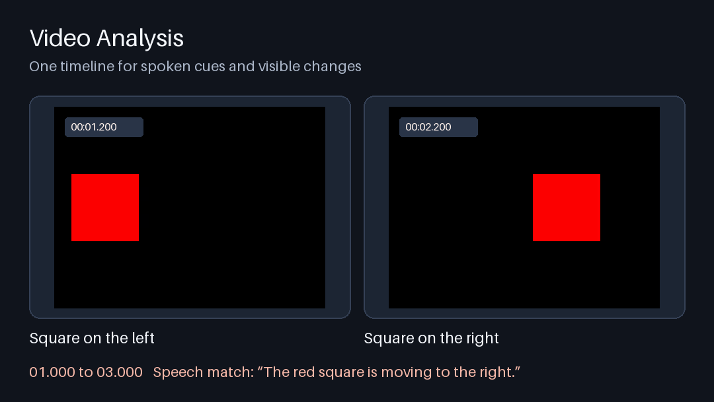

# Video Analysis

Transcribe audio, measure motion, and see what happened on screen at the same point in a recording. Video Analysis is a single Agent Skill for **Codex, Claude Code, Google Antigravity, and HKUDS DeepCode**. It also runs directly from a terminal.



[Play the sample clip](examples/speech-and-motion.mov) or [inspect its generated timeline](examples/timeline.json). Speech starts at about 1 second. The square changes position at about 2 seconds.

## Install

Install [uv](https://docs.astral.sh/uv/getting-started/installation/) and Git. Use a local agent session that can run commands and read the media or generated reports. On the first run, uv downloads Python and dependencies as needed, and the transcription tool downloads its speech models.

Clone the same repository into the location for your agent. Keep the whole directory so the agent can find the scripts and references next to `SKILL.md`.

| Agent | Install folder | How to invoke |
| --- | --- | --- |
| Codex | `~/.codex/skills/analyze-video` | Mention `$analyze-video` in your prompt |
| Claude Code | `~/.claude/skills/analyze-video` | Type `/analyze-video` |
| Google Antigravity App, CLI, or IDE | `~/.gemini/config/skills/analyze-video` or `.agents/skills/analyze-video` in your workspace | Type `/analyze-video` in the App or CLI, or ask for the skill by name |
| HKUDS DeepCode | `~/.agents/skills/analyze-video` or `.agents/skills/analyze-video` in your project | Select or mention `$analyze-video` |

Run the line for your agent:

```sh
# Codex
git clone https://github.com/clark970417-eng/video-analysis.git ~/.codex/skills/analyze-video

# Claude Code
git clone https://github.com/clark970417-eng/video-analysis.git ~/.claude/skills/analyze-video

# Google Antigravity App, CLI, or IDE
git clone https://github.com/clark970417-eng/video-analysis.git ~/.gemini/config/skills/analyze-video

# HKUDS DeepCode
git clone https://github.com/clark970417-eng/video-analysis.git ~/.agents/skills/analyze-video
```

For a workspace install in Antigravity or DeepCode, run the clone command from your project root and replace the destination with `.agents/skills/analyze-video`. Open a new agent session after installing if the skill does not appear. If automatic discovery is unavailable, ask the agent to read the installed `SKILL.md` and run its bundled command.

The installation locations come from the [Claude Code skills guide](https://code.claude.com/docs/en/skills), the [Antigravity skills guide](https://antigravity.google/docs/skills), and the [HKUDS DeepCode repository](https://github.com/HKUDS/DeepCode).

## Ask your agent

- **Summarize a recording.** “Use the analyze-video skill to summarize this video from its audio. Give me timestamps for the main points.”
- **Watch a specific section.** “Analyze 12:30 to 14:00 of this link. Explain what changes on screen while the presenter is talking.”
- **Find a spoken line.** “Find the first time they say ‘pricing,’ show me what’s on screen, and give me a link to that moment.”
- **Export captions.** “Transcribe this recording in its original language and export both SRT and WebVTT.”

Paste a public video or audio link, attach the media, or provide a local path the agent can read. To describe objects, interface changes, or visible text, the agent can inspect timestamped frames alongside the speech and motion reports.

## Run from the terminal

From the installed skill directory, try the included five-second sample:

```sh
uv run --script scripts/analyze_media.py --output ./sample-analysis \
  --language en --find "red square" --frame-at 00:01.2 --frame-at 00:02.2 \
  -- examples/speech-and-motion.mov
```

Use a fresh output directory for each run. Replace the sample path with a quoted media link or local path.

| Option | What it does |
| --- | --- |
| `--start 12:30 --end 14:00` | Analyze a section. Times in the combined timeline still refer to the original source. |
| `--language ja` | Tell the transcriber the language if you know it. |
| `--find "red square"` | Return chronological matches for a phrase within individual speech segments. |
| `--match-limit 4` | Limit the number of returned matches. |
| `--visual` | Export representative frames, or frames near matches when you use `--find`. |
| `--frame-at 00:02.2` | Export the first available frame at or after this time. Repeat for up to eight times. |

## What you get

| File | What it contains |
| --- | --- |
| `timeline.json` | Aligned speech and motion events, phrase matches, exported frame timestamps, timestamp issues, and jump links for supported YouTube and Vimeo URLs. |
| `transcript.txt` | Speech as recognized from the audio, with unclear passages marked when detected. |
| `motion.json` | Motion measurements for the full frame and its regions. |
| `subtitles.srt` and `subtitles.vtt` | Captions on the original source clock. |
| `frame-*.png` | Still frames for visual review when requested. |

The speech pass transcribes the recording’s audio locally. Motion measurements describe pixel changes and movement. The agent can use the optional still frames to identify objects or read visible text. The timeline accounts for known audio gaps and marks cues that span a gap as approximate.

Public links must be downloadable. Sign-in or protected media may require a local file, and selecting a time range can still require downloading the full source. The first run needs network access for dependencies and model weights. The sample uses a synthetic voice generated with [eSpeak NG](https://github.com/espeak-ng/espeak-ng).

## Test the skill

```sh
uv run --script tests/smoke.py
```

The smoke test checks transcription, motion, the sample’s one-second audio offset, time ranges, phrase search, frame export, subtitle files, jump-link formatting, and timestamp mapping across gaps.
